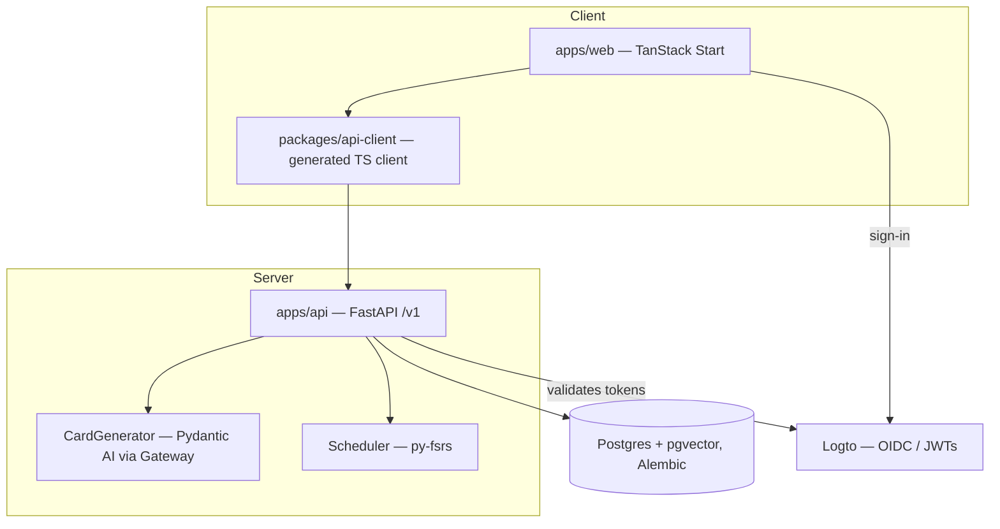

# Rekalled

A web app for turning material you're reading into flash cards — and actually remembering it.

Paste text into a Deck, an LLM drafts the cards, you check them once (every draft is kept by default), and then the home screen becomes **Study today**: the Cards that are due, a Memory score for every Card and Deck, and FSRS spaced-repetition scheduling that decides when you see each Card next.

- **Product spec:** [`docs/spec/Flashcard Platform — 4-day Prototype Spec.md`](docs/spec/Flashcard%20Platform%20—%204-day%20Prototype%20Spec.md)
- **CI/CD and deployment plan:** [`docs/deployment/PLAN.md`](docs/deployment/PLAN.md)
- **Releases and tags:** [`docs/deployment/TAGS.md`](docs/deployment/TAGS.md)
- **UI prototype (throwaway):** [`docs/prototype/Rekalled — Prototype.html`](docs/prototype/Rekalled%20—%20Prototype.html)
- **Contributing (strict TDD):** [`CONTRIBUTING.md`](CONTRIBUTING.md)

## What it does

- **Study today** is the first screen: due count, new count, a time estimate, and an overall Memory score with a 7-day forecast.
- **Study sessions** show one Card at a time — question, reveal the answer, rate it Again / Hard / Good / Easy (keyboard `1–4`, Space reveals). Each rating button shows when you'd see the Card next.
- **FSRS scheduling** runs on the server ([py-fsrs](https://github.com/open-spaced-repetition/py-fsrs)). Every Card has a Memory score (predicted recall right now, as a percentage); a Deck's score is the mean of its studied Cards.
- **Generation:** paste text as a Source; a Pydantic AI agent turns it into Draft Cards, each linked to the exact passage it came from. The draft check keeps everything by default — untick to drop, edit to fix, one action to save.
- **Reliability guarantees:** sources are saved before Generation runs (a failed run keeps your text and can be retried); draft commits are transactional and repeatable; reviews are idempotent (keyed by a client UUID), so a flaky network or an early exit never loses or doubles progress.
- **Privacy:** every User is a tenant. Identity is delegated to Logto (OIDC); FastAPI validates JWTs, and requesting another User's resources returns 404.

## Architecture

FastAPI owns all data and business logic; TanStack Start is a thin presentation layer.



- **Monorepo:** `apps/web` (TanStack Start, pnpm), `apps/api` (FastAPI, uv, flat `app/` package), and — from a later build slice — `packages/api-client`, a TypeScript client generated from FastAPI's OpenAPI spec with `@hey-api/openapi-ts`.
- **Data:** one Postgres database with pgvector, one Alembic-managed schema, SQLAlchemy 2 (async) + Pydantic v2. FSRS state lives on the Card row; every Review is appended to `review_logs`.
- **Deep modules at the seams:** `CardGenerator` (LLM behind a Protocol, with a deterministic `FakeCardGenerator`), `Scheduler` (the only code importing `fsrs`), and `auth/` (the only code that knows about Logto). Routes and services only see Protocols.
- **Single origin:** in dev, the Start dev server proxies `/v1/*` to FastAPI; in production, the reverse proxy does the same.
- **AI:** all model calls go through the [Pydantic AI Gateway](https://pydantic.dev/docs/ai/overview/gateway/) for cost, limits and traces in Logfire. Switching provider is a model-string change (`AI_MODEL`).

## Local development

Requires Docker, [uv](https://docs.astral.sh/uv/), pnpm and [just](https://github.com/casey/just). Copy `.env.example` to `.env` first (the justfile loads it).

```sh
just db          # Postgres with pgvector, via docker compose
just migrate     # alembic upgrade head
just api         # FastAPI with reload on :8000
just web         # web app on :3000 (proxies /v1 to the API)
```

Useful combined commands:

```sh
just test        # pytest (API) + vitest (web)
just lint        # ruff + ruff format + mypy (API); vp check (web)
just revision "add decks"   # autogenerate a migration
just images      # build both production images with CI's Dockerfiles
just smoke       # run the CI smoke test against those images
```

There is a dev auth bypass (fixed subject `dev|local`, overridable with `X-Dev-User`) that only works when `ENV=development` — the app refuses to start with it on anywhere else.

## Testing

CI runs on every PR (`ci-ok` is the single required check):

- **Repo lint:** actionlint, zizmor, gitleaks, hadolint, shellcheck.
- **API:** ruff + ruff format, mypy, pytest against a real Postgres service container, `alembic check` (migrations match the models), `uv audit`.
- **Web:** `vp check`, `vp test`, build, `pnpm audit --prod`.
- **Images:** both Docker images built with CI's Dockerfiles, smoke-tested (migrations on start, health, auth enforced) and Grype-scanned.

Per the spec, later slices add the OpenAPI client drift check (regenerate + `git diff --exit-code`) and one Playwright E2E against the Compose stack with the fake generator and fake auth. Real LLM calls and real Logto never run in CI.

Tests target behaviour through public interfaces only — the agreed seams are HTTP routes, the Scheduler (pure functions), CardGenerator output parsing, the frontend auth/API wrapper, and one E2E journey. See [`CONTRIBUTING.md`](CONTRIBUTING.md) for the full rules — they're strict, and enforced.

## Deployment

Full plan: [`docs/deployment/PLAN.md`](docs/deployment/PLAN.md); the step-by-step release and rollback walkthrough is [`docs/deployment/TAGS.md`](docs/deployment/TAGS.md). The short version:

- **Trunk-based:** one long-lived branch, `main`. Short-lived PRs (one per worktree), squash-merged. `ci-ok` and CodeRabbit are required checks.
- **Build once, promote the same image:** each merge to `main` builds `rekalled-api` and `rekalled-web` exactly once, pushed to DigitalOcean Container Registry as `sha-<12>`. Staging deploys that tag automatically. A semver tag retags the _same digest_ as `vX.Y.Z` — production runs the same bytes staging ran. No `latest`/`main`/`dev` tags.
- **Hosting:** Coolify "Docker Image" applications (not Compose, not Dockerfile), so rolling updates keep the old container serving until the new one is healthy. Deploy order is API, then web. A failed deploy never takes the old release down.
- **Migrations:** run at API start under a Postgres advisory lock. Because the old release still serves during the rollout, **every migration must be expand/contract** — add nullable/defaulted, backfill, drop only in a later PR.
- **Parity:** staging runs `ENV=production` and the same secret keys as prod (different values), so a forgotten variable surfaces as a failed staging deploy. No `VITE_*` build-time value may differ between environments.
- **Secrets:** Infisical at runtime. Coolify holds only the bootstrap (`INFISICAL_*` credentials); the API entrypoint logs in, drops the secret, and `exec`s the app with injected env vars. The web image has no secrets.
- **Supply chain:** every action pinned to a full commit SHA, Grype (not Trivy) image scans, SBOM + provenance attestations, `permissions: contents: read` defaults, actionlint/zizmor clean.
- **Release:** check staging → `git tag -a vX.Y.Z` on `main` → push. The promote workflow verifies the tag is on `main` and green on staging before touching production.
- **Rollback:** re-run the Promote workflow with the previous version. The existing image is redeployed — nothing is rebuilt. Works because migrations are backward compatible.
- **Hotfix:** same as a feature PR. No release branches; `main` is always releasable.

## Status

The 4-day prototype build delivers the architecture, the paste → generate → check → save flow, and studying with FSRS. Designed for but not yet built: URL/PDF import, Notes with semantic recall (pgvector is already enabled), the RAG `/ask` feature, the PWA, and billing/entitlements. Key decisions are recorded as ADRs (see the spec's final ticket).
