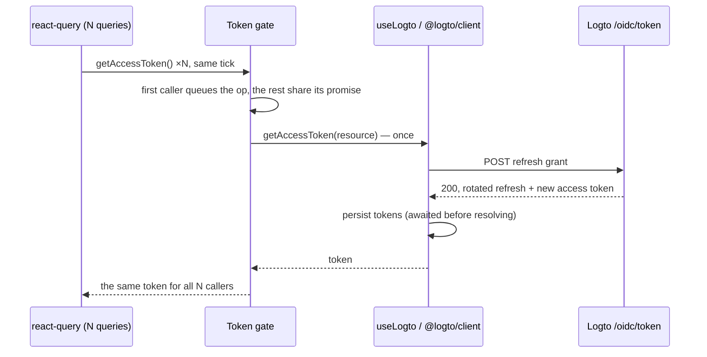
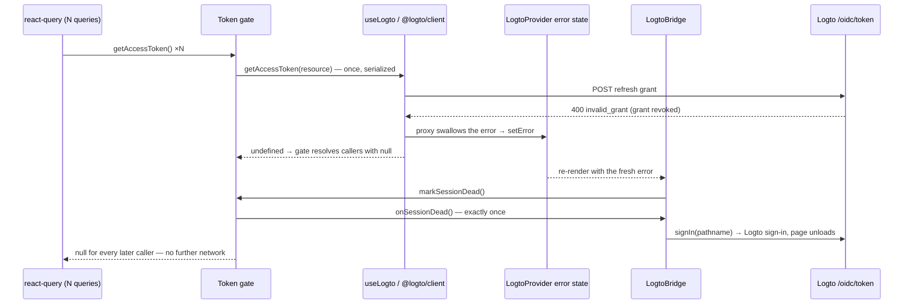

# Web auth: token refresh, and why there is a gate in front of it

The web app authenticates with Logto via `@logto/react` (see the
[integration quick-start](https://docs.logto.io/quick-starts/react) — we follow it
verbatim). Every react-query fetch goes through `createAuthFetch` →
`AuthState.getAccessToken` → the Logto client, which `POST /oidc/token`-refreshes the
access token when its cache is expired. Two Logto SDK behaviors make that innocent
pipeline able to brick a session, so `src/auth/` wraps token fetching in a small gate.
This document explains the failure it prevents, the exact invariants of the gate, and
how to verify it.

Everything Logto-specific lives in `apps/web/src/auth/` — enforced by
`apps/web/src/auth/boundary.test.ts`, which fails the build if any other file imports
`@logto/react`.

## The failure this prevents

Observed as `POST /oidc/token 400 invalid_grant` ("Grant request is invalid") repeating
8+ times per page load, forever, until the user manually signs in again:

1. **No mutex in the SDK.** `@logto/client` has no single-flight for refreshes: N
   parallel `getAccessToken()` calls each read the same stored refresh token and each
   fire their own POST (verified in `@logto/client@3.2.2`, `getAccessTokenByRefreshToken`).
2. **Logto rotates refresh tokens.** The winner of the race rotates the token; the
   losers replay the now-consumed token, and the provider revokes the entire grant
   (refresh-token rotation with replay detection, as Logto's provider implements).
   From that moment every refresh — this page load and all future ones — fails with
   `invalid_grant`.
3. **`invalid_grant` is terminal** (RFC 6749 §5.2): the grant is gone, no retry can ever
   succeed, but nothing in the pipeline knew that. react-query's default retries,
   refetch-on-focus and reconnect re-fired the POSTs indefinitely.

The fix splits the problem in two: **serialize token work** so the race in (1) can never
happen, and **make `invalid_grant` terminal** so (2)+(3) end in one clean redirect to
sign-in instead of a storm.

## The pieces

| File                                     | Role                                                                                                                                                                       |
| ---------------------------------------- | -------------------------------------------------------------------------------------------------------------------------------------------------------------------------- |
| `apps/web/src/auth/token-access.ts`      | Pure, injectable gate: serialization, sharing, terminal `invalid_grant` handling. No React, no Logto imports.                                                              |
| `apps/web/src/auth/logto-adapter.tsx`    | Wires the gate into `LogtoBridge`; recovers swallowed SDK errors; redirects to sign-in on a dead session; shares one in-flight `signIn` attempt (the SDK does not dedupe). |
| `apps/web/src/lib/auth-fetch.ts`         | Unchanged retry ladder: attaches Bearer token, on 401 forces one refresh + retry, on double-401 calls `signIn`.                                                            |
| `apps/web/src/auth/token-access.test.ts` | Gate behavior with deterministic fakes (never real Logto), per [CONTRIBUTING](../../CONTRIBUTING.md).                                                                      |
| `apps/web/src/lib/auth-fetch.test.ts`    | The 401 ladder, including the null-token path a dead session takes.                                                                                                        |

## The gate (`token-access.ts`)

`createTokenAccess(source, resource, onSessionDead?)` builds a per-bridge object with
`getAccessToken(options?)` and `markSessionDead()`. Its invariants:

- **Single-flight.** At most one `source.getAccessToken` runs at a time; concurrent calls
  return the _same promise_ (8 simultaneous callers → exactly 1 POST).
- **Strict serialization.** A queued op starts only after the previous one fully
  settled. The SDK awaits its rotated-refresh-token write before resolving, so by the
  time the next op runs, the stored token can never be a replayed one.
- **Forced refresh ordering.** `getAccessToken({ forceRefresh: true })` never rides a
  non-forced in-flight promise. It queues behind whatever is in flight, then
  `source.clearAccessToken()`, then fetches. Concurrent forced callers share one forced
  fetch. This comes from the 401 ladder in `auth-fetch.ts`: clear-then-fetch, ordered,
  never two POSTs with the same refresh token. If the session is flagged dead while the
  clear is pending, the op resolves `null` without fetching — no token POST may follow
  the start of recovery.
- **Terminal `invalid_grant`.** If a fetch rejects with an `invalid_grant`-shaped error,
  the gate marks itself dead, invokes `onSessionDead()` exactly once, and resolves
  `null`. While dead, every later call — forced or not — resolves `null` immediately with
  zero network.
- **Everything else propagates.** Network failures, 5xx and the SDK's
  `not_authenticated` rethrow unchanged and never flag the session dead. This matters:
  `not_authenticated` also occurs during SSR (no ID token on the server), and treating
  it as terminal would bounce users to sign-in on a server hiccup.
- **`markSessionDead()`** flips the same dead switch from the outside. It exists because
  of a quirk below, and is idempotent with the rethrow path: whichever fires first wins,
  the other no-ops.

Detecting `invalid_grant` (`isInvalidGrant`, also exported) is deliberately defensive
against SDK shape drift. It matches either:

- `error.code === "oidc.invalid_grant"` (SDK's own error codes), or
- `error.data.error === "invalid_grant"` — `data` carries the raw token-endpoint body;
  for a 400 `{ "error": "invalid_grant", ... }` response, the requester wraps it as
  `LogtoError("unexpected_response_error", body)`.

Near-misses intentionally **not** matched: `not_authenticated` (SDK `LogtoClientError`),
plain network errors, generic HTTP errors from the requester. Note that `isInvalidGrant`
matches on shape alone — it cannot tell a dead refresh grant from a stale authorization
code (RFC 6749 §5.2 uses the same error for both); telling them apart is the adapter's
job, via the callback-route guard below.

## The react SDK quirk: swallowed errors

`@logto/react@4.1.3`'s `useLogto()` wraps every client method in a proxy that **does not
rethrow** — it stores the error in the provider's `error` state (`useLogto().error`),
logs it, and resolves the call with `undefined`. So in production, terminal
`invalid_grant` reaches the gate as a _successful_ `undefined`, not a rejection. The
rejection-based path above still exists (and is what the unit tests exercise) because it
is the correct contract for any source that does rethrow — including a future SDK.

To recover the swallowed case, `LogtoBridge` watches the provider error state:

```ts
const { error } = logto; // from useLogto()
useEffect(() => {
  // On the callback route an invalid_grant is the (stale) authorization-code exchange,
  // which SignInCallback handles itself — not a dead refresh grant.
  if (window.location.pathname === "/callback") return;
  if (error && isInvalidGrant(error)) tokenAccess.markSessionDead();
}, [error, tokenAccess]);
```

Attribution rests on two facts. **Every refresh POST flows through the gate**, and the
other Logto calls that report into the provider error state fail with different shapes:
`getIdTokenClaims` failures are `not_authenticated`-shaped, and `fetchUserInfo` is unused.
The one other `POST /oidc/token` in the app — the `/callback` authorization-code exchange
— does **not** pass through the gate, and it also fails with `invalid_grant` when the
code is stale or revoked. That exchange is handled by `useHandleSignInCallback`, which
keeps its error in the hook's local state and renders `SignInCallback`'s own error UI,
so it does not reach `useLogto().error` as shipped. Two guards keep a future SDK from
breaking that assumption: the effect above ignores `invalid_grant` while on the callback
route, and `sanitizeReturnTo` never hands back `/callback`, so a misattributed exchange
error can neither flag the session dead nor corrupt the saved return path.

## What happens on the wire

| Scenario                  | POSTs to `/oidc/token`                      | Result                                                                                     |
| ------------------------- | ------------------------------------------- | ------------------------------------------------------------------------------------------ |
| Valid cached token        | 0                                           | SDK cache hit                                                                              |
| Expired token, live grant | exactly 1, shared by all concurrent queries | fresh token everywhere                                                                     |
| Revoked / bricked grant   | exactly 1, then dead flag                   | one redirect to sign-in; later callers get `null`, no network                              |
| Not signed in / SSR       | 0                                           | `not_authenticated` propagates or hook yields `undefined` → `null`; normal signed-out flow |
| Network failure           | bounded by react-query retries              | rejection propagates to queries; no dead flag, no redirect                                 |

### Sequence: routine expiry (the race that used to brick sessions)



### Sequence: dead grant (the old doom loop, now one redirect)



The effect fires within one React commit (~ms), normally before any API 401 could
return. If it ever loses that race, the double-401 ladder in `auth-fetch.ts` is the
backstop: a dead session resolves `null`, the request goes out unauthenticated, the API
answers 401, the forced retry is short-circuited to `null` (no POST), and the second 401
calls `signIn`. Bounded per query; the first navigation ends everything.

The dead flag lives for the bridge instance, i.e. the page load. Sign-in is a full
navigation, so the next load gets a fresh gate and fresh tokens — `dead` resets by
construction, not by special-case code.

## Testing and verification

Unit tests (`token-access.test.ts`, `auth-fetch.test.ts`) use injectable fakes and
deferred promises — deterministic, no timers, never real Logto. They cover the
serialization collapse, forced-refresh ordering (clear strictly between fetches),
sharing, both `invalid_grant` shapes, `not_authenticated`/network propagation, and the
`markSessionDead` convergence paths.

Manual checks (need `.env.local` Logto values; run with `just dev-logto`):

1. **Serialization**: sign in, then in DevTools set the
   `logto:<appId>:accessToken` entry's `expiresAt` to `0` and reload. Network tab shows
   exactly one `POST /oidc/token` per load; queries succeed.
2. **Terminal handling**: revoke the user's grant in the Logto console (or delete the
   Grant row in the tenant DB) and reload. One POST fails with `invalid_grant`, the app
   redirects to sign-in once — no loop, no further POSTs.

## Constraints kept intentionally

- **No react-query global changes** (`retry`, refetch settings): the gate makes them
  moot, so they stay at library defaults.
- **No API or infra changes**; the backend just sees fewer broken requests.
- **No Logto SDK upgrades.** If a future `@logto/react` rethrows errors, the rejection
  path simply becomes primary and the error-state effect never fires — no migration
  needed. If it keeps swallowing, the effect keeps covering it.
- Behavior verified against `@logto/react@4.1.3`, `@logto/client@3.2.2`,
  `@logto/js@6.1.2` (current `latest` at the time of writing).
